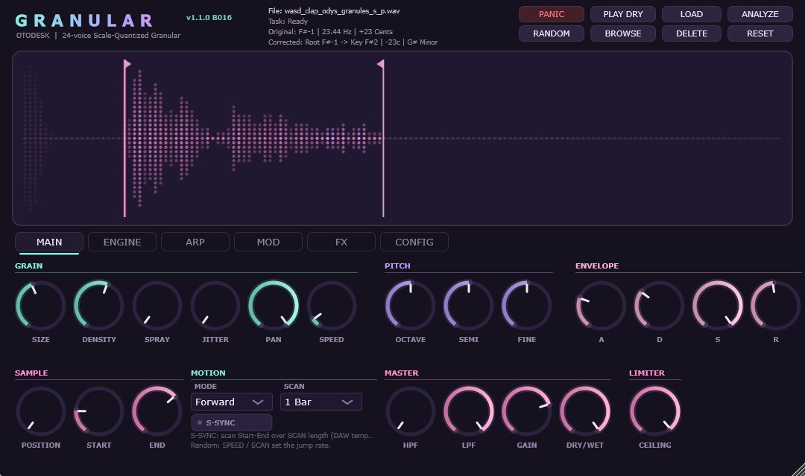
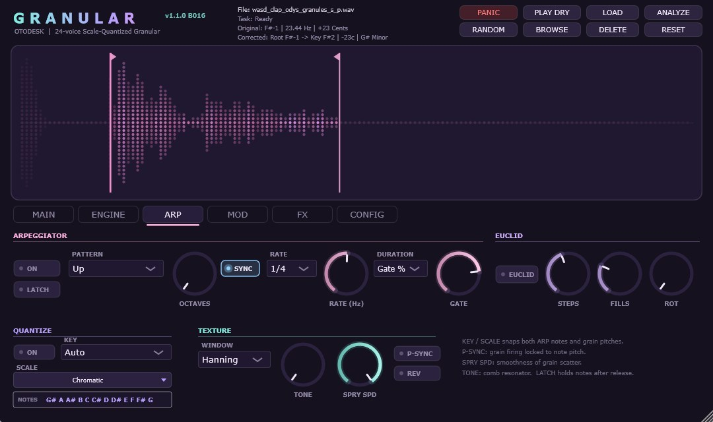
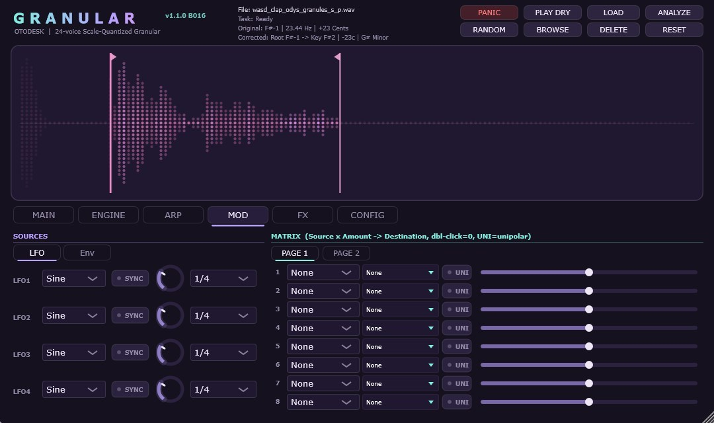
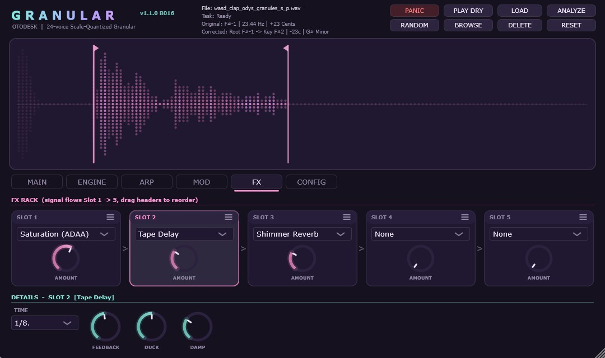
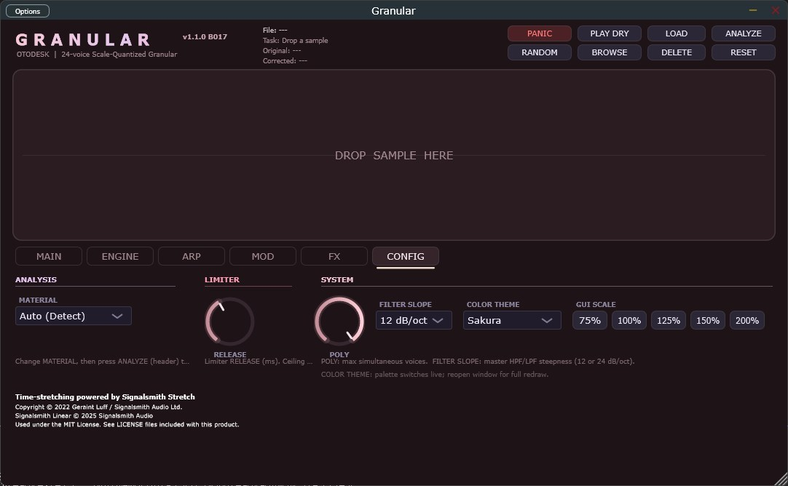

# GRANULAR


##


## Overview

**GRANULAR** is a 24-voice granular synthesiser VST3 built around one idea: **modulate the pitch as violently as you like — it still lands in key**.

In most granular instruments, pitch jitter, LFOs and random spray are applied *after* any scale correction, so the moment you add movement the result drifts out of tune. GRANULAR inserts its scale quantizer at the very end of the pitch chain: note, octave, semitone, fine tune, random jitter and every modulation slot are summed first, and only then snapped to the selected Key and Scale. Turn Pitch Jitter to ±24 semitones and the texture stays musical.

On top of that sits a complete instrument: pitch-synchronous grain firing that gives noise a playable pitch, a comb resonator for string-like tone, a 25-pattern arpeggiator (with Euclidean rhythm gating), a 16-slot modulation matrix, a drag-to-reorder 5-slot FX rack (with exclusive slot selection and FormantGate), a 3-column preset browser with 150 differentiated factory presets, and a dot-matrix waveform display coloured by the sample's own frequency content.

**Design goal:** the chaos of granular synthesis, kept in tune.


## Key Features

### Scale-Quantized Grain Pitch

* **Post-modulation quantization.** The final pitch — note + octave + semi + fine + random jitter + every matrix slot routed to a pitch destination — is snapped to Key + Scale as the last step. Modulation can be extreme without ever going out of key.
* **SCALE QUANTIZE toggle.** Enable or bypass the quantizer with a single click on the dedicated on/off button.
* **82 scales:** Free, Chromatic, Major, Natural Minor, Major & Minor Pentatonic, all church modes, harmonic/melodic/ethnic modes (Hirajoshi, In-Sen, Iwato, Ryukyu, Hungarian, Persian, Indian Ragas, etc.), symmetric & chord arpeggios. Key is Auto (from analysis) or fixed C–B.
* **ScaleNote real-time preview.** Shows the exact active scale notes (e.g. `C, D, E, F, G, A, B`) directly in the ARP tab.
* **Nearest-octave snapping.** The quantizer searches adjacent octaves too, so a note at the edge of a scale wraps naturally instead of jumping.

### 24 Voices × 100 Grains

* **Up to 100 grains per voice**, capped by a global 1200-grain CPU budget with voice stealing, so dense patches degrade gracefully instead of stalling the host.
* **Exponential density curve** (overlap 0.25–64) with 1/√overlap gain normalisation, keeping perceived level steady as density climbs.
* **Deterministic scheduler with collision-avoidance.** Density is treated as an overlap factor with ±25 % jitter, while `GrainSwarmScheduler` prevents multi-voice grain bunching at identical `(pos, pitch)` coordinates and distributes optional scale-locked Diatonic Swarm harmonies.
* **Mip-mapped 4-point Hermite interpolation.** 31-tap Blackman-windowed sinc pyramid (`2×–16×`) eliminates aliasing on extreme upward pitch shifts while keeping readout silky smooth.
* **Multi-Engine Core (ENGINE tab):** Switch seamlessly between **Granular**, **WSOLA** (normalized cross-correlation phase alignment), and **TD-PSOLA** (pitch-synchronous overlap-add with independent `Formant Shift` ±12 st).
* **Concatenative Grain Atlas:** Offline frame extraction computes brightness timbre, onset score, local F0 (`hasPitch`), and upward zero-crossing offsets, powering $O(\log N)$ **Timbre Scrubbing**, per-grain pitch locking, and transient-adaptive windows on the audio thread.
* **Per-Grain Sculpt & SVF:** Each grain carries individual window skew, pitch chirp glide, and a dedicated Zavalishin TPT State-Variable Filter (LP / BP / HP / Notch) with per-grain cutoff jitter.
* **Graceful voice stealing.** Stolen voices keep their old grains alive to decay through their own windows instead of being cut — the usual source of clicks when polyphony runs out.

### Making Noise Playable

* **P-SYNC (pitch-synchronous granular).** Grain firing intervals lock to the played note's frequency. The periodicity itself is perceived as pitch, so white noise or field recordings become playable across the keyboard.
* **TONE.** A note-tuned comb resonator (Karplus-Strong family) adds string-like harmonic structure. Feedback is soft-clipped so high settings resonate rather than explode.
* **Window shapes:** Hanning, Triangle, Square, Asymmetric.

### Sample Handling & Analysis

* **High-accuracy pitch analysis** — normalised autocorrelation with an octave-error guard and a 3-window median. Filename key hints (`Pad-C4`, `Bass(D)`, `Am_pluck`, `Ebmaj`) lock the key so the analyser only has to find the octave.
* **Root note tracking.** Only the cent deviation is corrected, so audio quality is essentially untouched. The detected note is stored as the root; play it and you hear the sample at its original pitch. Display follows Ableton convention (C3 = MIDI 60).
* **Material modes:** Auto (Detect) / Percussive / Melodic / Vocal.
* **Start / End** by knob or by dragging the markers on the waveform, with ~3 ms fades at the region edges so the End→Start wrap never clicks.
* **MOTION:** Forward / Backward / Ping-Pong / Random playhead movement. With S-SYNC on, the Start–End region is scanned over a musical length (1 beat – 8 bars) locked to host tempo.
* **Random jump rate.** In Random mode the playhead doesn't travel — it jumps to a new point at a fixed interval set by SPEED (≈30 jumps/sec at SPEED 1, frozen at 0) or by SCAN when S-SYNC is on. Jump timing is independent of DENSITY, so dense grain clusters can lurch slowly from place to place.

---

##


### Arpeggiator & Texture

* **25 patterns:** Up, Down, Up-Down, Down-Up, Up-Down (Incl), Converge, Diverge, Pedal Low, Pedal High, As Played, Random, Random Walk, Chord, Inward, Outward, Thumb Bass, Pinky Top, Zig-Zag, and more.
* **Euclidean Rhythm Generator:** Orthogonal Bjorklund $E(k, n, r)$ gating with configurable Steps (2–16), Fills (1–16), and Rotation (0–15).
* **Tempo-synced** (1/1 – 1/32 including dotted and triplet) **or free** (0.5–30 Hz), with Octaves (1–4), Duration (Gate % or a fixed note value), cross-block Strum, and LATCH.
* **Safe retrigger.** If a step would fire a note that is still sounding, a note-off is emitted first — this is what stops stacked voices (and sudden bursts) when you turn the Rate or Gate knob mid-pattern.
* Arpeggiator output passes through the same Key/Scale quantizer as the grains.

---

##


### Polyphonic Modulation Matrix

* **13 sources:** LFO × 4 (Sine / Triangle / Saw / Square / S&H / RK4 Lorenz Chaos, free 0.02–20 Hz or tempo-synced 1/1–1/32), per-voice ENV × 3 (loopable ADSR), Velocity, Note, Mod Wheel, Random (per-note S&H), and Poly/Channel Aftertouch (including MPE Slide CC74).
* **16 slots** across two pages, each with Source → Destination, bipolar Amount (double-click to zero) and a **UNI/BI** polarity toggle.
* **77 modulatable destinations** — Granular/Engine/Atlas/Swarm/Per-Grain SVF/Modal Resonator parameters, Pitch, Master Filter, Sample Start/End, Arp, Limiter, LFO/ENV rates & stages, and all FX rack parameters.
* **True Per-Voice Isolation:** Each of the 24 voices evaluates its own ADSR envelopes, Velocity, Note, Random S&H, and Aftertouch independently for voice parameters, while global modulation drives FX and Master stages.
* **Live range display.** Modulated knobs draw a white arc showing the reachable range plus a dot for the current value, computed through the same function the DSP uses. Position, Spray, Start and End are mirrored on the waveform in real time.
* **Loopable envelopes.** Turn LOOP on and an ENV becomes an A-D cycling generator — a second class of LFO with an arbitrary shape.

---

##


### FX Rack

Five slots in series, inserted before the master limiter. Drag any card header to reorder the chain; click a card to edit it in the Details area below.

* **Exclusive slot selection:** An effect active in one slot is automatically disabled (greyed out) in other slots to prevent redundant processing.
* **Saturation (ADAA)** — antiderivative anti-aliased, with **10 algorithms**: Soft Tanh, Hard Clip, Triode, Tape, Transformer, JFET, BJT, Wavefold, Exciter, Cubic. Includes a pre-highpass and output trim.
* **Ensemble Chorus** — Rate, Depth, Width.
* **Tape Delay** — tempo-synced time, Feedback, Damp, and Duck (input-triggered ducking).
* **Freeze** — Size (20–1000 ms), Feedback up to 0.99, Damp.
* **Shimmer Reverb** — 16-channel FDN with an octave shifter. Decay, Shimmer, Damp, Mod.
* **FormantGate** — rhythmic stutter slicer with vowel formant resonance (Rate, Pattern, Depth, Decay, Vowel).

A master **DRY/WET** knob on the MAIN tab blends the whole rack, and is itself a modulation destination.

---

##


### Config & Safety

* **Analysis** — Material Mode, plus third-party attribution.
* **Limiter** — Release time (Ceiling lives on the MAIN tab).
* **System** — Polyphony (1–24 voices), master filter slope (12 / 24 dB/oct), and **ten colour themes**: Midnight, Sakura, Ocean, Forest, Sunset, Mono, Neon, Vaporwave, Amber, Arctic.
* **PANIC button** — Situated left of PLAY DRY. Instantly silences all active voices, reverb tails, and delay buffers if notes hang.
* **Aspect-ratio locked UI scaling** — Drag the lower-right handle to scale the UI from **75% to 200%** (810×480 to 2160×1280). Window size is saved with your DAW project.

### Dot Waveform Display

The waveform is drawn as stacked dots, **coloured by the sample's own frequency content** — warm for low-frequency regions, cool for high, with brightness contrast that survives even the monochrome theme. Grain firings appear as dots in real time, positioned and coloured by pitch and fading over time. Click or drag the waveform to move Position; drop a file anywhere to load it.

### Preset Browser

A professional **3-column hierarchical browser** with **150 factory presets across 12 categories**:

* **3 Columns:**
  - **CATEGORY:** `All`, `Favorites ★`, 12 factory categories (`Pads & Ambient`, `Textures`, `Rhythmic`, `Bass`, `Leads`, `Cinematic`, `Glitch`, `Experimental`, `Pitch`, `Engine & Formant`, `Swarm & Modal`, `Euclid & GrainFX`), `User`.
  - **SUBCATEGORY:** Dynamically lists subcategories for the selected category (starts with `All`). Click to filter instantly.
  - **PRESET:** Filtered presets with name, star icon, and category/subcategory tags.
* **"Pitch" category (40 presets):** Emphasizes Tone comb resonance, scale quantization, and varied timing across 8 subcategories (5 presets each): Pluck, Bell, Lead, Pad, Bass, Arp, Gate, Drone.
* **Phase 4 Showcase Categories (30 presets):**
  - `Engine & Formant` (10 presets): WSOLA phase-aligned stretch, TD-PSOLA decoupled formant shifting, and Concatenative Grain Atlas timbre navigation.
  - `Swarm & Modal` (10 presets): Diatonic Swarm layering and 8-Mode Modal Resonator physical modeling.
  - `Euclid & GrainFX` (10 presets): Bjorklund Euclidean arp rhythms, intra-grain Envelope Skew / Pitch Chirp, and per-grain Zavalishin SVF modulation.
* **Rich MOD & Zero-Duplication FX:** All 150 presets utilize coherent MOD matrix routing (LFOs, loopable envelopes, Velocity, Mod Wheel, Random, Aftertouch) and gain-compensated saturation with zero FX duplication across all slots.
* **Star Favorites (★):** Click the gold star icon (`★` / `☆`) at the left edge of any preset row for instant one-click toggle.
* **Modal Save Dialog:** Clicking **SAVE** opens a dialog to enter Category (combobox), Subcategory (text), and Preset Name.
* **Cross-field Search:** The search box queries preset names, categories, and subcategories simultaneously.
* **Smart Musical RANDOM:** Header RANDOM builds cohesive patches from 8 curated archetypes (`Pad`, `Modal Crystal`, `Swarm Choir`, `Formant Lead`, `Euclid Arp`, `Gate Groove`, `Granular Bass`, `Kinetic Lab`), generating Phase 1–4 engine/FX parameters, safe collision-free MOD routing (3–6 slots), and zero duplicate FX while protecting output gain, polyphony, and color theme.

User presets are stored in **Documents/OTODESK/Granular/Presets/**. Samples are saved as a path reference, not embedded.


## Parameter Reference

### Grain

| Parameter | Range | Default | Description |
|---|---|---|---|
| Size | 0.02 – 0.5 s | 0.15 s | Grain length |
| Density | 0.0 – 1.0 | 0.5 | Exponential overlap curve (0.25–64×) |
| Spray | 0.0 – 1.0 | 0.0 | Randomises grain start position |
| Jitter | 0 – 2400 cents | 0 | Random pitch offset, applied **before** quantization |
| Pan | 0.0 – 1.0 | 1.0 | Stereo spread |
| Speed | 0.0 – 2.0 | 1.0 | Playhead rate. In Random mode, the jump rate (0 = frozen) |
| Window | Hanning / Triangle / Square / Asymmetric | Hanning | Grain envelope shape |
| REV | Off / On | Off | Reverse grain playback |

### Pitch & Quantize

| Parameter | Range | Default | Description |
|---|---|---|---|
| Octave | -3 – +3 | 0 | Octave shift |
| Semi | -24 – +24 st | 0 | Semitone shift |
| Fine | -100 – +100 ct | 0 | Cent fine tune |
| Scale Quantize | Off / On | Off | Dedicated toggle button |
| Key | Auto / C – B | Auto | Auto uses the analysed key |
| Scale | 82 types | Free | Applied after all modulation |
| ScaleNote | Real-time preview | — | Displays active notes of the selected scale |
| P-SYNC | Off / On | Off | Locks grain firing to note frequency |
| TONE | 0.0 – 1.0 | 0.0 | Note-tuned comb resonator |

### Envelope & Sample

| Parameter | Range | Default | Description |
|---|---|---|---|
| Attack | 0.0005 – 10.0 s | 0.02 s | Power curve — 0.5 ms snap to 10 s pad swell |
| Decay | 0.001 – 10.0 s | 0.1 s | Exponential |
| Sustain | 0.0 – 1.0 | 1.0 | Sustain level |
| Release | 0.001 – 10.0 s | 0.5 s | Exponential |
| Position | 0.0 – 1.0 | 0.0 | Grain origin, ~20 ms glide when moved |
| Start / End | 0.0 – 1.0 | 0.0 / 1.0 | Playback region, ~3 ms edge fades |
| Motion | Forward / Backward / Ping-Pong / Random | Forward | Playhead behaviour |
| S-SYNC | Off / On | Off | Scan Start–End over a musical length. In Random mode, jump once per SCAN |
| Scan | 1 Beat – 8 Bars | 1 Bar | Scan length when S-SYNC is on |

### Engine & Modal Resonator (ENGINE Tab)

| Parameter | Range | Default | Description |
|---|---|---|---|
| Engine Mode | Granular / WSOLA / TD-PSOLA | Granular | Playback synthesis engine |
| Formant Shift | -12 – +12 st | 0.0 st | Spectral formant shift (decoupled from pitch in TD-PSOLA) |
| Swarm Mix | 0.0 – 1.0 | 0.0 | Scale-locked diatonic harmony layer density |
| Atlas Pitch | 0.0 – 1.0 | 0.0 | Per-grain F0 flattening from Concatenative Grain Atlas |
| Timbre | 0.0 – 1.0 | 0.5 | Target spectral brightness in the Grain Atlas |
| Atlas Amt | 0.0 – 1.0 | 0.0 | Attract grain positions toward matching Atlas timbre |
| Skew | -1.0 – +1.0 | 0.0 | Envelope skew (negative = percussive snap, positive = swell) |
| Chirp | -12 – +12 st | 0.0 st | Intra-grain continuous pitch glide |
| Filter Mode | Off / LP / BP / HP / Notch | Off | Per-grain Zavalishin TPT SVF topology |
| Cutoff / Res | 20–20000 Hz / 0.1–10.0 | 20000 Hz / 0.7 | Per-grain filter frequency & resonance |
| Flt Jitter | 0.0 – 1.0 | 0.0 | Per-grain random filter cutoff spread (±3 oct) |
| Ratio Mode | Scale / Harmonic / Marimba / Bell / Plate | Scale | 8-mode stereo modal resonator bank tuning curve |
| Modal Mix | 0.0 – 1.0 | 0.0 | Wet blend of physical modal resonator bank |
| Decay / Damp / Inharm | 0.05–5.0 s / 0–1 / 0–1 | 0.8 s / 0.4 / 0.0 | Modal T60 decay, HF rolloff, & stiffness dispersion |

### Master

| Parameter | Range | Default | Description |
|---|---|---|---|
| HPF | 20 – 2000 Hz | 20 Hz | TPT SVF, per-sample smoothed |
| LPF | 200 – 20000 Hz | 20000 Hz | TPT SVF, per-sample smoothed |
| Gain | -36 – +12 dB | 0 dB | Output level, ramped |
| Dry/Wet | 0.0 – 1.0 | 1.0 | FX rack blend (modulatable) |
| Ceiling | -6 – 0 dB | -0.1 dB | Look-ahead brick-wall limiter ceiling |

### Arpeggiator

| Parameter | Range | Default | Description |
|---|---|---|---|
| Pattern | 25 types | Up | Note order |
| Rate | 1/1 – 1/32 (sync) or 0.5–30 Hz | 1/8 | SYNC toggles between them |
| Octaves | 1 – 4 | 1 | Octave range |
| Duration | Gate % / 1/32 / 1/16 / 1/8 / 1/4 | Gate % | Note length mode |
| Gate | 0.05 – 1.0 | 0.8 | Used in Gate % mode |
| Latch | Off / On | Off | Holds the chord after release |
| Euclid On / Steps / Fills / Rot | Off/On, 2–16, 1–16, 0–15 | Off, 8, 5, 0 | Bjorklund Euclidean step gating |

### Modulation

| Parameter | Range | Default | Description |
|---|---|---|---|
| Source | 13 sources | None | LFO 1–4, ENV 1–3, Velocity, Note, Mod Wheel, Random, Aftertouch |
| Destination | 77 destinations | None | All Synth/Engine/Atlas/Modal/Filter/Arp/FX/Mod parameters |
| Amount | -1.0 – +1.0 | 0.0 | Double-click to reset |
| UNI | Off (bipolar) / On (unipolar) | Off | Output polarity |
| LFO Rate | 0.02 – 20 Hz, or 1/1 – 1/32 | 1.0 Hz | SYNC toggles between them |
| ENV A / D / S / R | 0.001–10 s / 0–1 | 0.05 / 0.5 / 1.0 / 0.3 | Per-voice ADSR (LOOP cycles A-D as complex LFO) |

### FX

| FX | Parameters |
|---|---|
| **Saturation (ADAA)** | ALGO (10 types), DRIVE (1–12×), PRE-HPF (20–2000 Hz), TRIM (±12 dB) |
| **Ensemble Chorus** | RATE (0.05–4 Hz), DEPTH, WIDTH |
| **Tape Delay** | TIME (1/2 – 1/16T), FEEDBACK (0–0.95), DUCK, DAMP |
| **Freeze** | SIZE (20–1000 ms), FEEDBACK (0–0.99), DAMP |
| **Shimmer Reverb** | DECAY, SHIMMER, DAMP, MOD |
| **FormantGate** | RATE (1/2 – 1/32), PATTERN (8 types), DEPTH, DECAY, VOWEL |

### Config

| Parameter | Range | Default | Description |
|---|---|---|---|
| Material | Auto (Detect) / Percussive / Melodic / Vocal | Auto | Analysis profile — press ANALYZE after changing |
| Lim Release | 1 – 500 ms | 50 ms | Limiter recovery |
| Poly | 1 – 24 voices | 24 | Max simultaneous voices |
| Filter Slope | 12 / 24 dB/oct | 12 dB/oct | Master HPF/LPF steepness |
| Color Theme | 10 themes | Midnight | Fully applied when the UI is reopened |


## Signal Flow

```
MIDI In
   │
   ▼
[Arpeggiator] ──► [Scale Quantizer]
   │
   ▼
┌───────────────────────────────────────────────────────────┐
│  Voice 1..24   (up to 100 grains each, poly ModMatrix)    │
│    Concatenative Atlas · Collision-Avoidance Scheduler    │
│    Engine: Granular / WSOLA / TD-PSOLA (+ Formant Shift)  │
│    Mip-mapped 4-point Hermite · Per-grain TPT SVF         │
│                                                           │
│    note + oct + semi + fine + jitter + swarm + MOD        │
│                     │                                     │
│                     ▼                                     │
│           [Scale Quantizer]  ← key/scale                  │
│                     │                                     │
│    Skewed Window · Pitch Chirp · P-SYNC · TONE comb       │
│    ADSR · Pan Spread                                      │
└───────────────────────────────────────────────────────────┘
   │
   ▼
[Scale-Tuned Modal Resonator Bank]  (8 stereo TPT modes)
   │
   ▼
[Master HPF] ─► [Master LPF] ─► [Gain]     (12 or 24 dB/oct)
   │
   ▼
[Safety soft-clip]
   │
   ▼
[FX Rack]  5 slots in series (exclusive selection, drag to reorder)
   Saturation (ADAA) / Chorus / Delay / Freeze / Velvet Shimmer / FormantGate
   │
   ▼
[Dry/Wet blend] ─► [Look-Ahead Brick-wall Limiter (~1.5 ms)] ─► Out
```

The quantizer sitting **inside** the voice, after modulation is summed, is what makes extreme pitch movement stay musical. Look-ahead limiter latency (~1.5 ms, e.g. 72 samples at 48 kHz) is reported cleanly to the host via PDC (`setLatencySamples`).


## Real-Time Safety

Granular synthesis generates clicks for a living, and a click is broadband — it excites the reverb and comes back as a burst. The defences are layered:

* **PANIC Button.** One-click emergency flush of all voices, delay lines, and reverb tails.
* **Grain edge fades.** Reads fade to zero ~3 ms before the Start/End boundary, so the wrap never produces a discontinuity.
* **Non-destructive voice stealing.** A stolen voice keeps its existing grains so they decay through their own windows; only genuinely free voices clear their grain list and comb buffer.
* **Position glide.** Position moves are smoothed per-sample (~20 ms), so dragging the knob can't teleport the playhead into a loud region. Note-on seeds the value immediately, so attacks stay tight.
* **Bounded feedback.** The TONE comb write is soft-clipped (±1.5), delay feedback tops out at 0.95, Freeze at 0.99, and the reverb FDN injects as `in*(1-fb) + loop*fb` so its steady-state gain converges to 1.0 instead of 1/(1-fb).
* **DC blockers** on the reverb and delay feedback paths (~19 Hz) prevent the slow sub-sonic build-up that otherwise shows up as periodic swells.
* **Safety soft-clip** between the synth and the FX rack, then a brick-wall limiter at the output.
* **Smoothed parameters.** Filter cutoff is smoothed per sample in the TPT SVF; output gain is ramped; FX wet amounts are smoothed so a modulated 0↔1 transition can't step.
* **Background loading.** File decoding and pitch analysis run on a dedicated worker thread, with the ingest state set before the thread starts so re-analysis can't race the audio thread for the shared buffer.


## 📚 Manual

Quick manuals covering every tab and parameter, plus starting-point settings and troubleshooting:

[  ](Source/Assets/Granular_Manual_EN.md)
[  ](Source/Assets/Granular_Manual_JP.md)


## Installation

1. Download `Granular.vst3` from the Releases page.
2. Copy it to your VST3 directory:
   ```
   C:\Program Files\Common Files\VST3\
   ```
3. Rescan plugins in your DAW.

### Build Requirements

* **JUCE** 8.0.x — place at `C:/JUCE` or update `JUCE_PATH` in `CMakeLists.txt`
* **CMake** 3.22 or higher
* **Visual Studio** 2022 (MSVC, C++20)

```bash
cmake -B build -DJUCE_PATH=C:/JUCE
cmake --build build --config Release
```

`COPY_PLUGIN_AFTER_BUILD` is enabled, so the VST3 is copied to the system VST3 folder automatically after a successful build.


## System Requirements

* **OS:** Windows 10 / 11 (64-bit)
* **Format:** VST3 / Standalone
* **Tested Host:** Ableton Live 11 / 12, FL Studio, Studio One, Reaper

> ⚠️ **Compatibility Notice:** Verified operation is confirmed in **Ableton Live**. Other DAWs may work but are currently unverified.


## Tips

* **Turn noise into a pad:** load a field recording, turn P-SYNC on, Size to about 0.2 s, Density to 0.7, and pick a Scale. The firing rate becomes the pitch and the scale keeps chords consonant.
* **Chaos that stays in key:** set Pitch Jitter to 1200–2400 cents and choose Minor Pentatonic. Every grain lands on a scale tone, so the result is a shimmering cloud rather than noise.
* **String-like tone:** raise TONE to about 0.6 with a short Grain Size. The comb resonator tunes to the played note and adds a plucked-string body.
* **Tempo-locked scanning:** turn S-SYNC on with Scan = 2 Bars and Motion = Ping-Pong for a texture that breathes with the track.
* **Evolving movement:** assign ENV 1 with LOOP on to Position, and a slow LFO to Grain Size. The white arcs on both knobs show exactly how far each will travel.
* **Modulate the pitch hard:** route an LFO to `Pitch (st)` at full Amount. Because the quantizer runs after the matrix, even ±24 semitones of movement stays in the selected key.
* **Precision knob work:** right-click any knob to type an exact value. Double-click a matrix Amount slider to zero it.


## License

This project is licensed under the GNU Affero General Public License v3.0 (AGPLv3) — see [LICENSE](LICENSE) for details.

This software is built with the **JUCE 8** framework. In accordance with JUCE 8's open-source licensing terms, this entire project is distributed under the AGPLv3.

### Third-Party

Time-stretching is powered by **Signalsmith Stretch**, used under the MIT License.

* Signalsmith Stretch — Copyright © 2022 Geraint Luff / Signalsmith Audio Ltd. — [LICENSE](Source/third_party/signalsmith-stretch/LICENSE-stretch.txt)
* Signalsmith Linear — Copyright © 2025 Signalsmith Audio — [LICENSE](Source/third_party/signalsmith-stretch/signalsmith-linear/LICENSE-linear.txt)

> When distributing binaries, include both MIT licence files alongside the plugin — the MIT terms require the copyright and permission notices to accompany every copy, not just the source repository.

The same attribution is shown in-plugin on the **CONFIG** tab, below the ANALYSIS section.

RubberBand is **not** used, so no GPL / commercial licensing restrictions apply from that direction.


## Credits

**Developer:** @kijyoumusic (OTODESK)

**Framework:** JUCE 8.0.x

**Target DAW:** Ableton Live 11 / 12

**DSP References:**
- Signalsmith Audio — *Signalsmith Stretch* (phase-vocoder time-stretching)
- McLeod & Wyvill — *"A Smarter Way to Find Pitch"* (MPM, 2005)
- Zavalishin — *"The Art of VA Filter Design"* (TPT/SVF topology)
- Parker, Zavalishin & Le Bivic — *"Reducing the Aliasing of Nonlinear Waveshaping Using Continuous-Time Convolution"* (ADAA, 2016)
- Karplus & Strong — *"Digital Synthesis of Plucked-String and Drum Timbres"* (1983)
- Verhelst & Roelands — *"An overlap-add technique based on waveform similarity (WSOLA)"* (1993)
- Moulines & Charpentier — *"Pitch-synchronous waveform processing techniques for text-to-speech synthesis using diphones"* (TD-PSOLA, 1990)
- Toussaint — *"The Euclidean Algorithm Generates Traditional Musical Rhythms"* (2005)
- Chaigne & Askenfelt — *"Numerical simulations of piano strings / wooden bars"* (Modal inharmonicity & damping)


## Support

* **Social / Demo:** [@kijyoumusic](https://x.com/kijyoumusic)
* [](https://otodesk4193.github.io/OTODESK_SITE/)
